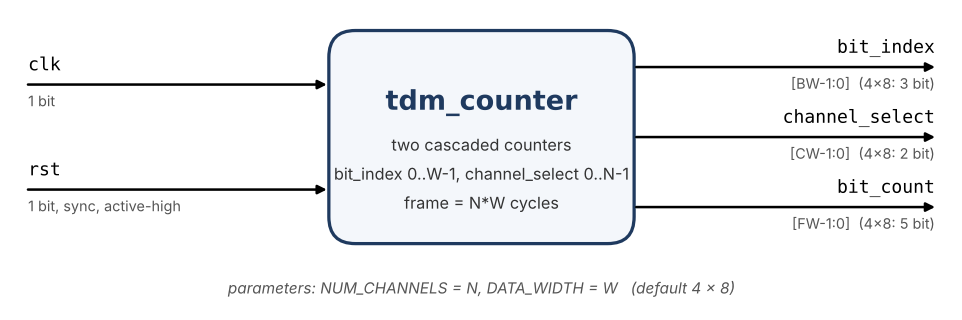
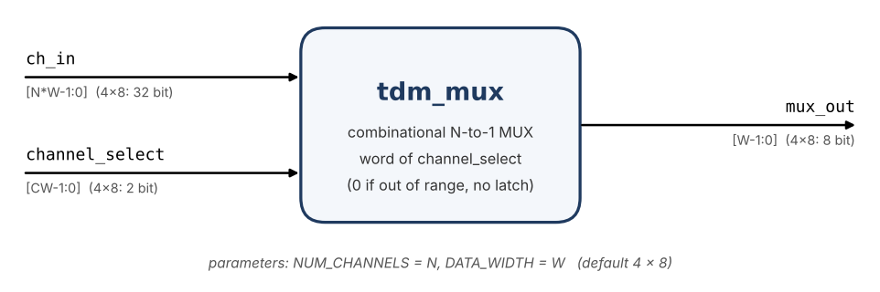
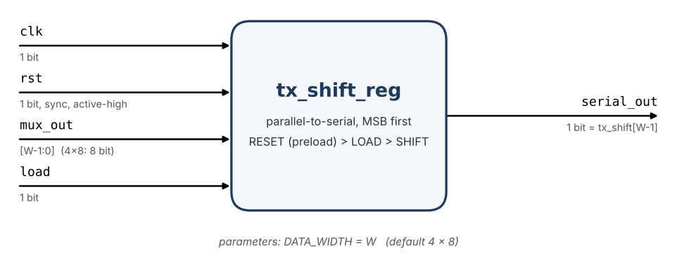
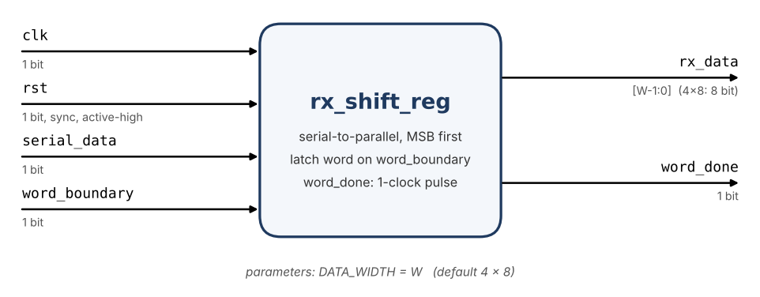
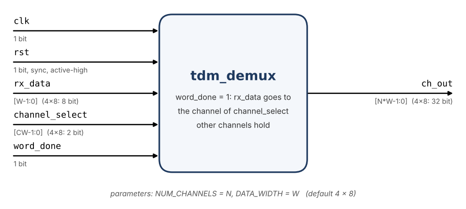
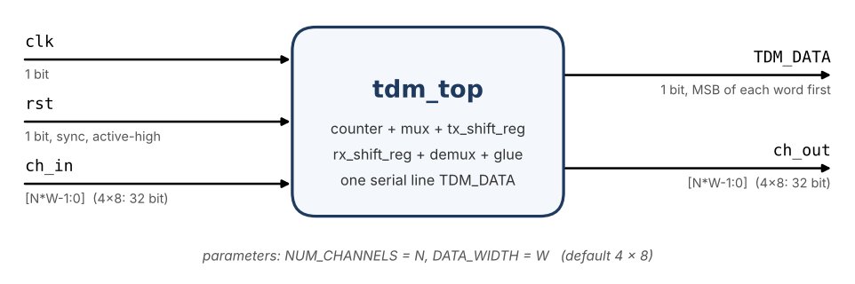

# TDM 4-Channel Multiplexer/Demultiplexer — Verilog RTL Project

A counter-driven (no FSM) **Time Division Multiplexing (TDM) multiplexer/demultiplexer** in Verilog,
parameterized by the number of channels and the bits per slot (default 4 channels × 8 bits), with self-checking testbenches, a Python golden model that cross-checks the RTL, and Vivado
implementation results.

| | |
|---|---|
| Design | 6 RTL modules, 1 shared counter, parameterized `NUM_CHANNELS` × `DATA_WIDTH` (default 4 × 8) over a single `TDM_DATA` wire, see [Section 2.1](#21-parameters) |
| System testbench | **38 / 38** checks pass (Icarus Verilog and Vivado XSIM), see [Section 8](#8-verification) |
| Golden model | **200 / 200** random vectors match bit-for-bit (stream, outputs, latency) for 4 × 8, plus other sizes; **46 / 46** message cases (4 × 8, 4 × 16, 8 × 8, 3 × 12) give identical RTL and golden result files, see [Section 8.3](#83-python-golden-model-rtl-vs-reference) and [8.5](#85-message-mode-regression) |
| Latency | 33 clocks from reset to first valid frame, 40 clocks (max 41) after a mid-stream data change (4 × 8); in general cold start `N·W + 1`, worst case `N·W + W + 1` |
| Implementation | Vivado 2020.2, Kintex-7 `xc7k70tfbv676-1`, default 4 × 8, after place and route: **22 LUTs, 64 FFs**, no BRAM/DSP; timing met at 100 MHz (WNS +6.921 ns, WHS +0.059 ns), see [Section 9](#9-implementation-results) |

---

## Table of Contents

1. [Quick Start](#1-quick-start)
2. [System Overview](#2-system-overview)
3. [Block Diagram](#3-block-diagram)
4. [Repository Structure](#4-repository-structure)
5. [Module Index](#5-module-index)
6. [Timing Contract (glue layer in `tdm_top`)](#6-timing-contract-glue-layer-in-tdm_top)
7. [Interface Specifications](#7-interface-specifications)
8. [Verification](#8-verification)
9. [Implementation Results](#9-implementation-results)
10. [Limitations](#10-limitations)
11. [Future Work](#11-future-work)
12. [License](#12-license)

---

## 1. Quick Start

```bash
git clone https://github.com/Ygbzyem/TDM-4---Channel-Multiplerxer-Demultiplexer.git
cd TDM-4---Channel-Multiplerxer-Demultiplexer
```

You need **Python 3.8+** and **one** simulator: Icarus Verilog (`iverilog`, `vvp`) or Vivado (XSIM).
Keep the project in a folder whose path contains only ASCII characters (no accents) if you simulate
with Vivado.

```bash
python scripts/run_tests.py                      # system testbench -> 38/38 PASS
python golden_model/run_verification.py          # RTL vs Python golden model -> ALL CHECKS PASSED
python golden_model/golden_model.py              # golden model of input/input_vectors.txt -> results/golden_result.txt
python golden_model/run_message_regression.py    # many message cases, RTL vs golden result files -> 0 failures
```

Add `--sim xsim` to either command to use Vivado XSIM instead of Icarus. The full guide, including
the Vivado GUI flow and expected output, is in **[docs/SIMULATION.md](docs/SIMULATION.md)**; the golden
model is documented in **[golden_model/README.md](golden_model/README.md)**.

---

## 2. System Overview

The system is a single, fully periodic data path — no FSM, no handshake, no synchronization protocol, and no
alternate modes.

Instead of four wires for four channels, time is divided into fixed slots and each channel only "speaks" during
its own slot, in a fixed rotation:

- Each channel **word** (`DATA_WIDTH` bits, 8 by default) occupies exactly `DATA_WIDTH` clock cycles, MSB first.
- One **frame** is `NUM_CHANNELS` consecutive words, always in the order CH0 → CH1 → … → (repeat):
  `NUM_CHANNELS × DATA_WIDTH` clock cycles per frame (32 for the default 4 × 8).
- There is exactly **one counter module** in the whole system (`tdm_counter`: bit position `bit_index` inside a word
  and channel slot `channel_select`), the single timing reference for both transmit and receive sides. For the
  default 4 × 8, `{channel_select, bit_index}` is exactly the 5-bit `bit_count` 0→31→0. No FSM exists in the design.

On the transmit side the active channel's byte is loaded into a shift register and sent out one bit per clock. The
receive side counts on the same beat, so it already knows which channel each completed byte belongs to and writes
it into the matching output register; no extra synchronization bits are needed.

One practical detail appears once this runs in real hardware: the shift registers are synchronous, so a value
loaded into them only takes effect on the *next* clock edge. The design compensates with a small glue layer in
`tdm_top` ([Section 6](#6-timing-contract-glue-layer-in-tdm_top)), and the outputs then match the inputs exactly
once the pipeline has filled.

**Latency.** Outputs are not valid instantly: after reset the first correct frame is available after **33 clocks**;
after a mid-stream change of the inputs it takes **40 clocks** (worst case 41 = 31 clocks waiting for the channel's
load slot + 8 clocks to serialize + 2 output registers). For `N` channels of `W` bits: cold start `N·W + 1`, worst case
`(N·W − 1) + W + 2 = N·W + W + 1`. These numbers are measured in simulation and checked by
the golden model ([Section 8.3](#83-python-golden-model-rtl-vs-reference)).

### 2.1 Parameters

| Parameter | Default | Allowed | Meaning |
|---|---|---|---|
| `NUM_CHANNELS` | 4 | ≥ 2 | number of channels sharing `TDM_DATA` |
| `DATA_WIDTH` | 8 | ≥ 2 | bits per channel word (16 = 2 bytes per channel) |

Derived values: frame = `NUM_CHANNELS × DATA_WIDTH` cycles; `ch_in` / `ch_out` are packed `{CH0, CH1, …}` with
channel 0 as the most significant word, exactly like one line of the input files (4 × 8: `a53cf05a` → CH0 = a5 …
CH3 = 5a; 4 × 16: `1234abcd00ff8001`); cold-start latency = `NUM_CHANNELS × DATA_WIDTH + 1` cycles (33 for 4 × 8, 65 for 4 × 16).
Non-power-of-two values (for example 3 channels or 12 bits) are supported. Set the parameters on `tdm_top`
(`tdm_top #(.NUM_CHANNELS(4), .DATA_WIDTH(16)) u_tdm (...)`); the RTL uses Verilog-2001 only (no `$clog2`).

---

## 3. Block Diagram


*Data flow: CH0–CH3 → `tdm_mux` (combinational) → `tx_shift_reg` (parallel→serial, MSB-first) → serial
`TDM_DATA` → `rx_shift_reg` (serial→parallel, MSB-first) → `tdm_demux` (updates an output only when
`word_done = 1`) → CH0_OUT–CH3_OUT, all timed off the single `tdm_counter`. Shown for the default 4 × 8.*

---

## 4. Repository Structure

```
.
├── src/                         # synthesizable RTL
│   ├── tdm_counter.v            #   bit / channel counter (the only timing source)
│   ├── tdm_mux.v                #   N-to-1 channel multiplexer
│   ├── tx_shift_reg.v           #   parallel-to-serial shift register
│   ├── rx_shift_reg.v           #   serial-to-parallel shift register
│   ├── tdm_demux.v              #   word router to the channel output registers
│   └── tdm_top.v                #   top level + timing glue layer
├── techbench/                   # testbenches
│   ├── tb_tdm_top.v             #   full-system test (3 layers of checks)
│   ├── tb_tdm_top_filebased.v   #   one case from input/input_vectors.txt (default), or the vector regression
│   └── testbench.md             #   walkthrough of tb_tdm_top.v
├── golden_model/                # Python reference model + automatic RTL comparison (see its README)
│   ├── run_verification.py      #   vector regression: simulate + compare in one command (any N x W)
│   ├── run_message_regression.py #  message regression: many cases, RTL vs golden result files
│   ├── golden_model.py          #   reference model; run it to get results/golden_result.txt for input/input_vectors.txt
│   ├── compare_output.py, export_excel.py, ...
│   └── verification_logs/       #   latest result files, report and Excel workbook
├── input/                       # input_vectors.txt (the one case), test_cases.txt (all cases), input_vectors.hex / random_vectors.hex (regression)
├── results/                     # Vivado synthesis / post-route reports, screenshots, rtl_result.txt and golden_result.txt of the last case
├── scripts/
│   ├── run_tests.py             #   runs every self-checking testbench
│   └── synth.tcl                #   Vivado batch synthesis + implementation, utilization/timing reports
├── constraint/constraints.xdc   # clock constraint (pin assignments pending a target board)
├── image/                       # system diagram (Project_diagram.png), module diagrams (modules/*.png)
├── docs/                        # SIMULATION.md, golden_vs_rtl.md (line-by-line mapping) and design notes
├── LICENSE
└── README.md
```

---

## 5. Module Index

All modules take the parameters `NUM_CHANNELS` and/or `DATA_WIDTH` (defaults 4 and 8).

| # | Module | File | Role | Ports and diagram |
|---|--------|------|------|------|
| 1 | `tdm_counter` | `tdm_counter.v` | The system's single timing source: `bit_index` (0 … `DATA_WIDTH`−1) and `channel_select` (0 … `NUM_CHANNELS`−1). Also outputs the frame position `bit_count` for the testbenches. | [7.1](#71-tdm_counter) |
| 2 | `tdm_mux` | `tdm_mux.v` | Combinational N-to-1 MUX. Selects the active channel's word for serialization. | [7.2](#72-tdm_mux) |
| 3 | `tx_shift_reg` | `tx_shift_reg.v` | Parallel-to-serial shift register, MSB-first. Loads a new word on `load`, otherwise shifts left once per clock. | [7.3](#73-tx_shift_reg) |
| 4 | `rx_shift_reg` | `rx_shift_reg.v` | Serial-to-parallel shift register, MSB-first. Shifts continuously; on `word_boundary` it latches the word into `rx_data` and pulses `word_done`. | [7.4](#74-rx_shift_reg) |
| 5 | `tdm_demux` | `tdm_demux.v` | Writes the completed word into the selected channel of `ch_out`, gated by `word_done`. | [7.5](#75-tdm_demux) |
| 6 | `tdm_top` | `tdm_top.v` | Top-level integration: instantiates the five modules above plus the glue logic that derives correctly-phased `mux_select` / `load` / `word_boundary` / `demux_select` from the counter outputs. | [7.6](#76-tdm_top) |

---

## 6. Timing Contract (glue layer in `tdm_top`)

`tdm_counter` only produces the raw `bit_index` and `channel_select`. Because `tx_shift_reg` and `rx_shift_reg` are
synchronous, three small pieces of glue logic in `tdm_top.v` translate them into correctly-phased control signals:

| Signal | Formula in `tdm_top` | Same as in the 4 × 8 design | Why |
|---|---|---|---|
| `mux_select` | `last_bit ? next channel : channel_select` | `(bit_count + 1)[4:3]` | Look one step ahead so `tx_shift_reg` receives the *upcoming* channel's word on the edge that ends the current word. |
| `load`, `word_boundary` | `last_bit = (bit_index == DATA_WIDTH−1)` | `bit_count[2:0] == 3'b111` | Fire on the **last** bit of the current word, so a word is loaded/captured exactly on time. |
| `demux_select` | `channel_select` delayed by 1 clock | same | Keeps the channel selector aligned with `word_done`, a registered (1-cycle-late) pulse from `rx_shift_reg`. |

Without the look-ahead the channels rotate permanently by one (inputs `AA/BB/CC/DD` appear as `DD/AA/BB/CC`), which
is why the glue layer exists. `tx_shift_reg` also **preloads `mux_out` on reset**: the counter is held at 0 during reset,
so `mux_select` already points at CH0 and CH0 is the first channel to complete a round trip after reset. Details and
worked examples are in [docs/tdm_top.md](docs/tdm_top.md).

---

## 7. Interface Specifications

`N` = `NUM_CHANNELS`, `W` = `DATA_WIDTH`. `CW`, `BW`, `FW` = bits needed to count 0 … N−1, 0 … W−1 and 0 … N·W−1 (at least 1;
for the default 4 × 8: 2, 3 and 5). The width column gives the general width and the value for 4 × 8. All resets are
synchronous and active-high. The diagrams show each module as a black box with its ports.

### 7.1 `tdm_counter`



| Port | Direction | Width (4 × 8) | Description |
|---|---|---|---|
| `clk` | Input | 1 | Shared clock; every register of the system works on its rising edge |
| `rst` | Input | 1 | Synchronous, active-high reset; clears `bit_index` and `channel_select` to 0 |
| `bit_index` | Output | BW (3) | Position of the bit inside the current word, counts 0 → W−1 and wraps; `bit_index == W−1` marks the last bit of a word |
| `channel_select` | Output | CW (2) | Channel slot now on the wire, 0 → N−1; increases by 1 each time `bit_index` wraps. Raw value: it is not fed directly to `tdm_mux` / `tdm_demux` (see [Section 6](#6-timing-contract-glue-layer-in-tdm_top)) |
| `bit_count` | Output | FW (5) | Position inside the frame, `channel_select × W + bit_index` (0 → N·W−1; for 4 × 8 the old 5-bit `bit_count`). Used by the testbenches only; not used in `tdm_top`, so synthesis removes it |

One frame = N·W clock cycles (32 for 4 × 8). The counters compare with W−1 and N−1, so N and W need not be powers of two.

### 7.2 `tdm_mux`



| Port | Direction | Width (4 × 8) | Description |
|---|---|---|---|
| `ch_in` | Input | N·W (32) | The N parallel input channels, packed `{CH0, CH1, …, CH(N−1)}`; CH0 is the most significant word, `ch_in[N·W−1 -: W]` |
| `channel_select` | Input | CW (2) | Which channel to send: 0 → CH0, 1 → CH1, …, N−1 → CH(N−1). In `tdm_top` it is driven by the look-ahead `mux_select` |
| `mux_out` | Output | W (8) | Word of the selected channel (combinational); 0 if `channel_select` ≥ N, so no latch is inferred |

### 7.3 `tx_shift_reg`



| Port | Direction | Width (4 × 8) | Description |
|---|---|---|---|
| `clk` | Input | 1 | Shared clock |
| `rst` | Input | 1 | Synchronous, active-high reset; **preloads** `mux_out` (CH0's word) instead of clearing, so CH0 is the first word on the wire |
| `mux_out` | Input | W (8) | Word to send, from `tdm_mux` |
| `load` | Input | 1 | High in the last cycle of a word (`bit_index == W−1`); the next word is captured on that clock edge |
| `serial_out` | Output | 1 | `tx_shift[W−1]`, the current MSB; this is `TDM_DATA` |

Priority inside the always block: **RESET > LOAD > SHIFT** (shift left, a 0 enters at the LSB).

### 7.4 `rx_shift_reg`



| Port | Direction | Width (4 × 8) | Description |
|---|---|---|---|
| `clk` | Input | 1 | Shared clock |
| `rst` | Input | 1 | Synchronous, active-high reset; clears the shift register, `rx_data` and `word_done` |
| `serial_data` | Input | 1 | Bit on the wire (`TDM_DATA`), shifted in MSB first on every clock |
| `word_boundary` | Input | 1 | Same timing as `load`: high while the last bit of a word is on the wire |
| `rx_data` | Output | W (8) | Received word `{rx_shift[W−2:0], serial_data}`, latched on the clock edge that ends the word |
| `word_done` | Output | 1 | One-clock pulse, high in the cycle after `word_boundary`; tells `tdm_demux` that `rx_data` is new |

### 7.5 `tdm_demux`



| Port | Direction | Width (4 × 8) | Description |
|---|---|---|---|
| `clk` | Input | 1 | Shared clock |
| `rst` | Input | 1 | Synchronous, active-high reset; clears every output word to 0 |
| `rx_data` | Input | W (8) | Completed word from `rx_shift_reg` |
| `channel_select` | Input | CW (2) | Which output word to write; in `tdm_top` this is `demux_select` (`channel_select` delayed by one clock) |
| `word_done` | Input | 1 | Write enable: the selected channel is updated only when it is 1 |
| `ch_out` | Output | N·W (32) | Received channels, same packing as `ch_in`; the channels that are not selected keep their value |

### 7.6 `tdm_top`



| Port | Direction | Width (4 × 8) | Description |
|---|---|---|---|
| `clk` | Input | 1 | Shared clock (100 MHz in `constraints.xdc`) |
| `rst` | Input | 1 | Synchronous, active-high reset of the whole system |
| `ch_in` | Input | N·W (32) | Parallel input channels `{CH0, CH1, …, CH(N−1)}` (4 × 8: `{CH0, CH1, CH2, CH3}`, e.g. `a53cf05a` → CH0 = a5 … CH3 = 5a) |
| `TDM_DATA` | Output | 1 | The serial line: one bit per clock, channel after channel, MSB of each word first |
| `ch_out` | Output | N·W (32) | Reconstructed channels, same packing as `ch_in`; slot f of channel c appears in cycle f·N·W + (c+1)·W + 1 |

Parameters are set on the instance: `tdm_top #(.NUM_CHANNELS(4), .DATA_WIDTH(16)) u_tdm (...)`. Internal signals of the glue
layer (`mux_select`, `load`, `word_boundary`, `demux_select`) are described in [Section 6](#6-timing-contract-glue-layer-in-tdm_top).

---

## 8. Verification

### 8.1 System testbench (`python scripts/run_tests.py`)

| Testbench | Checks | What it covers |
|---|---|---|
| `tb_tdm_top` | **38 / 38 PASS** | full system (`tdm_top`), see below; Icarus Verilog, also confirmed on Vivado XSIM |

The project does not keep separate per-module testbenches: every module is exercised through `tdm_top`, and the timing
glue between the modules is the part that actually needs checking.

`tb_tdm_top` checks the complete `tdm_top` in three independent layers: (1) round trip per frame including `0x00`/`0xFF`
and a mid-stream reset, (2) a bit-level comparison of all 32 bits on `TDM_DATA` against the expected MSB-first sequence
(so a TX bug and an RX bug that cancel out cannot hide), and (3) a regression of 20 back-to-back random frames. A walkthrough is in
[techbench/testbench.md](techbench/testbench.md).

### 8.2 Simulator portability

`tb_tdm_top` deasserts reset with a `#1` delay after the clock edge. Without it, the assignment would land in the same
time step as the edge the DUT samples `rst` on, and the Verilog standard does not fix the order, so the result could
differ between simulators from byte-identical source.

### 8.3 Python golden model (RTL vs reference)

`techbench/tb_tdm_top_filebased.v` (with `RUN_CASE = 0`) reads packed vectors `{CH0, CH1, …}` from `input/*.hex`,
drives the real `tdm_top`, and writes three result files. `golden_model/run_verification.py` then compares **every
vector** with the independent Python model ([golden_model/README.md](golden_model/README.md)). Any size:
`--channels N --width W` (vectors from `random_regression.py --channels N --width W`).

| Check | RTL side | Golden side |
|---|---|---|
| Bit stream | N·W bits on `TDM_DATA` of one frame, from `bit_count == 0` | `serialize()`, compared cycle by cycle |
| Outputs | settled channel outputs | `deserialize()` result |
| Latency | clocks until every output is correct | bound `N·W + W + 1` (41 for 4 × 8) |

| Run | Vectors | Result | Latency (cycles) |
|---|---|---|---|
| `input/input_vectors.hex` (hand-picked, corner values) | 20 | all PASS | cold start 33, mid-stream 40 |
| `input/random_vectors.hex` (`--n 200 --seed 42`) | 200 | all PASS | cold start 33, mid-stream 32–40 |
| random, 25 vectors each: 2 × 2, 3 × 12, 5 × 3, 7 × 9, 8 × 16, 4 × 32 | 150 | all PASS | cold start `N·W + 1`, every value ≤ `N·W + W + 1` |

Each run also appends to `golden_model/verification_logs/verification_results.xlsx` (Summary / Results / History sheets).
A mid-stream latency below 40 appears when a channel's byte equals the previous vector's byte, so that channel needs no update.

### 8.4 One case, compared by eye

The testbench and the golden model read **one** input file, `input/input_vectors.txt`: the size, then the whole message
of every device (hex). Each message is cut into `DATA_WIDTH`-bit slots; frame f carries slot f of every channel (CH0,
CH1, … in turn, then back to CH0), and a channel whose message is finished sends 0. The receiver puts the slots of each
channel back together. All prepared cases are in `input/test_cases.txt`.

```
// example: CASE 2 of input/test_cases.txt (copied into input/input_vectors.txt)
NUM_CHANNELS = 4
DATA_WIDTH   = 8              // bits per slot
CH0 = 0123456789abcdef        // 8 slots: 01 23 45 67 89 ab cd ef
CH1 = deadbeef                // 4 slots, then 00
CH2 = cafe
CH3 = 5a
```

1. Put the case in `input/input_vectors.txt` (copy one from `input/test_cases.txt`).
2. In `techbench/tb_tdm_top_filebased.v` set `NUM_CHANNELS`, `DATA_WIDTH` to the values of the file. `REPO_DIR` can
   stay `"."` when the Vivado project is inside the repository (the testbench finds `input/` up to 6 folders above the
   simulation folder); otherwise set it to the repository folder (absolute path, forward slashes). The testbench stops
   with an error if the file is not found or its size does not match.
3. Run the simulation to the end (Vivado: Run Simulation, then **Run All**; Icarus:
   `iverilog -g2001 -o sim/tb techbench/tb_tdm_top_filebased.v src/*.v && vvp sim/tb` from the repository folder).
   → `results/rtl_result.txt`
4. `python golden_model/golden_model.py` → prints every step and writes `results/golden_result.txt`.
5. Open the two files side by side (VS Code: `code --diff results/rtl_result.txt results/golden_result.txt`).
   Only the `# source` line differs when RTL and model agree. Both files are overwritten by the next run.

Each result file holds the messages and their slots, a cycle-by-cycle trace (time in ns, frame, channel and bit number
on `TDM_DATA`, all outputs), every received slot with the cycle in which it reached its output, and the rebuilt
messages. Which golden-model line corresponds to which RTL line is listed in [docs/golden_vs_rtl.md](docs/golden_vs_rtl.md).

### 8.5 Message-mode regression

`python golden_model/run_message_regression.py` runs the cases of `input/test_cases.txt` and random cases through the
same testbench and through the golden model, and compares the two result files of every case line by line (only
`# source` may differ) together with the testbench self-check. Options: `--sizes 4x8,4x16,8x8,3x12`, `--random N`,
`--seed`, `--max-digits`, `--sim xsim`. Committed run (`verification_logs/message_report.md`, `message_results.xlsx`):
the 6 library cases and 10 random cases each of 4 × 8, 4 × 16, 8 × 8 and 3 × 12, **46 / 46 PASS**. With the mux
look-ahead removed on purpose every case fails at the first wrong bit on `TDM_DATA`.

---

## 9. Implementation Results

Vivado 2020.2, target device Kintex-7 `xc7k70tfbv676-1`, default 4 × 8, 10 ns (100 MHz) clock from `constraint/constraints.xdc`.
`vivado -mode batch -source scripts/synth.tcl` produces all three reports in `results/`:
[`tdm_top_utilization_synth.rpt`](results/tdm_top_utilization_synth.rpt) (after synthesis),
[`tdm_top_utilization_impl.rpt`](results/tdm_top_utilization_impl.rpt) and
[`tdm_top_timing_impl.rpt`](results/tdm_top_timing_impl.rpt) (after place and route).

| Resource | After synthesis | After place and route | Available | Utilization (routed) |
|---|---|---|---|---|
| Slice LUTs | 22 | 22 | 41,000 | 0.05% |
| Slice Registers (flip-flops) | 63 | 64 | 82,000 | 0.08% |
| Slices | – | 19 | 10,250 | 0.19% |
| Bonded IOB | 67 | 67 | 300 | 22.33% |
| Block RAM | 0 | 0 | 135 | 0% |
| DSP | 0 | 0 | 240 | 0% |
| BUFGCTRL (clock buffer) | 1 | 1 | 32 | 3.13% |

Primitives after place and route: 64 `FDRE` (all with synchronous reset, no latches), 15 `LUT6` + 6 `LUT3` + 2 `LUT5` + 2 `LUT2` +
2 `LUT1` + 1 `LUT4` (28 LUT primitives in 22 LUT sites; 6 sites use both outputs O5 and O6), 34 `IBUF` / 33 `OBUF` and 1 `BUFG`.
Bonded I/O is the dominant usage, as expected with 4 × 8-bit inputs and 4 × 8-bit outputs plus clock, reset and the serial pin.

The RTL declares 64 register bits (5 + 8 + 8 + 8 + 1 + 2 + 32). Synthesis keeps 63: `rx_shift[7]` is written but never read (only
`rx_shift[6:0]` is used when the word is latched), so it is removed. After implementation the count is back to 64 because
`opt_design` adds one copy of a register, `u_tx/tx_shift_reg[7]_lopt_replica`, which appears as the endpoint of the worst setup path.

### Timing (post-route, `results/tdm_top_timing_impl.rpt`)

| Check | Worst slack | Total violation | Failing endpoints | Endpoints |
|---|---|---|---|---|
| Setup (WNS) | **+6.921 ns** | 0.000 ns | 0 | 106 |
| Hold (WHS) | **+0.059 ns** | 0.000 ns | 0 | 106 |
| Pulse width (WPWS) | **+4.600 ns** | 0.000 ns | 0 | 65 |

Vivado reports: *All user specified timing constraints are met.* The worst setup path runs from `u_counter/bit_index_reg[0]` through
three LUTs (look-ahead `mux_select`, then the `tdm_mux` select) to the `tx_shift_reg[7]` replica: 3.104 ns of data delay (0.559 ns logic,
2.545 ns routing). The worst hold path is the `rx_shift_reg[5]` → `rx_shift_reg[6]` shift, with a 0.059 ns margin.

A rough estimate from the setup slack is a minimum clock period of about 10 − 6.921 = 3.08 ns, i.e. roughly 320 MHz. This is an
estimate from one run, not a guaranteed maximum frequency. The 100 MHz clock is a placeholder, not a requirement from the
specification. `check_timing` lists 33 inputs without input delay and 33 outputs without output delay, so the I/O paths are not part
of this result (no board and no pin assignment yet).

---

## 10. Limitations

- **Channel order after a mid-stream data change is not fixed.** Adding four input buffer registers that update only when `bit_count` wraps to 0 would remove this.
- **Rare edge cases are not covered yet:** back-to-back resets, a very short reset pulse, clock jitter. This only needs more test cases.
- **Parameter range.** `NUM_CHANNELS` and `DATA_WIDTH` must both be at least 2. `tb_tdm_top.v` (38 checks) is written for 4 × 8; every other size is checked by `tb_tdm_top_filebased.v` with `run_verification.py --channels --width` and `run_message_regression.py --sizes`. The testbench holds up to 256 vectors, 256 slots and 512 hex digits per message.
- **XSIM in the Python regressions** is implemented like the existing `--sim xsim` flow but was only run with Icarus Verilog for the message mode.
- **No error detection and no frame synchronization marker.** A parity bit per byte and a small marker detector are feasible additions.
- **Out of scope:** CRC error detection and clock recovery / clock-domain crossing for a physically separate TX/RX clock.

---

## 11. Future Work

- Constrain the I/O delays (`set_input_delay` / `set_output_delay`) once a board is chosen, so that input and output paths are analysed too.
- Choose a target board, set the real clock frequency and pin assignments in `constraint/constraints.xdc`.
- Add the input buffer registers described in [Section 10](#10-limitations) and extend the golden model to check them.
- Cover the remaining edge cases (short reset, back-to-back resets) in the testbenches.

---

## 12. License

Released under the MIT License, see [LICENSE](LICENSE).
