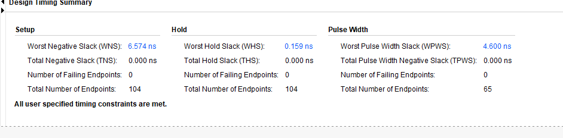

# TDM 4-Channel Multiplexer/Demultiplexer — Verilog RTL Project

A counter-driven (no FSM) **4-channel Time Division Multiplexing (TDM) multiplexer/demultiplexer** in
Verilog, with self-checking testbenches, a Python golden model that cross-checks the RTL, and Vivado
implementation results.

| | |
|---|---|
| Design | 6 RTL modules, 1 shared counter, parameterized `NUM_CHANNELS` × `DATA_WIDTH` (default 4 × 8) over a single `TDM_DATA` wire, see [Section 2.1](#21-parameters) |
| System testbench | **38 / 38** checks pass (Icarus Verilog and Vivado XSIM), see [Section 8](#8-verification) |
| Golden model | **200 / 200** random vectors match bit-for-bit (stream, outputs, latency), see [Section 8.3](#83-python-golden-model-rtl-vs-reference) |
| Latency | 33 clocks from reset to first valid frame, 40 clocks (max 41) after a mid-stream data change (4 × 8); cold start = `NUM_CHANNELS × DATA_WIDTH + 1` in general |
| Implementation | Vivado 2020.2 (post-implementation), Kintex-7 `xc7k70tfbv676-1`, default 4 × 8: **22 LUTs, 63 FFs**, no BRAM/DSP; timing met at 100 MHz (WNS +6.574 ns, WHS +0.159 ns), see [Section 9](#9-implementation-results) |

---

## Table of Contents

1. [Quick Start](#1-quick-start)
2. [System Overview](#2-system-overview)
3. [Block Diagram](#3-block-diagram)
4. [Repository Structure](#4-repository-structure)
5. [Module Index](#5-module-index)
6. [Timing Contract (glue layer in `tdm_top`)](#6-timing-contract-glue-layer-in-tdm_top)
7. [Interface Specifications](#7-interface-specifications)
8. [Verification](#8-verification)
9. [Implementation Results](#9-implementation-results)
10. [Limitations](#10-limitations)
11. [Future Work](#11-future-work)
12. [License](#12-license)

---

## 1. Quick Start

```bash
git clone https://github.com/Ygbzyem/TDM-4---Channel-Multiplerxer-Demultiplexer.git
cd TDM-4---Channel-Multiplerxer-Demultiplexer
```

You need **Python 3.8+** and **one** simulator: Icarus Verilog (`iverilog`, `vvp`) or Vivado (XSIM).
Keep the project in a folder whose path contains only ASCII characters (no accents) if you simulate
with Vivado.

```bash
python scripts/run_tests.py                      # system testbench -> 38/38 PASS
python golden_model/run_verification.py          # RTL vs Python golden model -> ALL CHECKS PASSED
python scripts/run_single_case.py                # messages of input/message_case.txt: two result files to compare
python scripts/run_single_case.py --case input/message_case_4x16.txt  # same, 2 bytes per slot
```

Add `--sim xsim` to either command to use Vivado XSIM instead of Icarus. The full guide, including
the Vivado GUI flow and expected output, is in **[docs/SIMULATION.md](docs/SIMULATION.md)**; the golden
model is documented in **[golden_model/README.md](golden_model/README.md)**.

---

## 2. System Overview

The system is a single, fully periodic data path — no FSM, no handshake, no synchronization protocol, and no
alternate modes.

Instead of four wires for four channels, time is divided into fixed slots and each channel only "speaks" during
its own slot, in a fixed rotation:

- Each channel **word** (`DATA_WIDTH` bits, 8 by default) occupies exactly `DATA_WIDTH` clock cycles, MSB first.
- One **frame** is `NUM_CHANNELS` consecutive words, always in the order CH0 → CH1 → … → (repeat):
  `NUM_CHANNELS × DATA_WIDTH` clock cycles per frame (32 for the default 4 × 8).
- There is exactly **one counter module** in the whole system (`tdm_counter`: bit position `bit_index` inside a word
  and channel slot `channel_select`), the single timing reference for both transmit and receive sides. For the
  default 4 × 8, `{channel_select, bit_index}` is exactly the 5-bit `bit_count` 0→31→0. No FSM exists in the design.

On the transmit side the active channel's byte is loaded into a shift register and sent out one bit per clock. The
receive side counts on the same beat, so it already knows which channel each completed byte belongs to and writes
it into the matching output register; no extra synchronization bits are needed.

One practical detail appears once this runs in real hardware: the shift registers are synchronous, so a value
loaded into them only takes effect on the *next* clock edge. The design compensates with a small glue layer in
`tdm_top` ([Section 6](#6-timing-contract-glue-layer-in-tdm_top)), and the outputs then match the inputs exactly
once the pipeline has filled.

**Latency.** Outputs are not valid instantly: after reset the first correct frame is available after **33 clocks**;
after a mid-stream change of the inputs it takes **40 clocks** (worst case 41 = 31 clocks waiting for the channel's
load slot + 8 clocks to serialize + 2 output registers). These numbers are measured in simulation and checked by
the golden model ([Section 8.3](#83-python-golden-model-rtl-vs-reference)).

### 2.1 Parameters

| Parameter | Default | Allowed | Meaning |
|---|---|---|---|
| `NUM_CHANNELS` | 4 | ≥ 2 | number of channels sharing `TDM_DATA` |
| `DATA_WIDTH` | 8 | ≥ 2 | bits per channel word (16 = 2 bytes per channel) |

Derived values: frame = `NUM_CHANNELS × DATA_WIDTH` cycles; `ch_in` / `ch_out` are packed `{CH0, CH1, …}` with
channel 0 as the most significant word, exactly like one line of the input files (4 × 8: `a53cf05a` → CH0 = a5 …
CH3 = 5a; 4 × 16: `1234abcd00ff8001`); cold-start latency = `NUM_CHANNELS × DATA_WIDTH + 1` cycles (33 for 4 × 8, 65 for 4 × 16).
Non-power-of-two values (for example 3 channels or 12 bits) are supported. Set the parameters on `tdm_top`
(`tdm_top #(.NUM_CHANNELS(4), .DATA_WIDTH(16)) u_tdm (...)`); the RTL uses Verilog-2001 only (no `$clog2`).

---

## 3. Block Diagram


*Data flow: CH0–CH3 → `tdm_mux` (combinational) → `tx_shift_reg` (parallel→serial, MSB-first) → serial
`TDM_DATA` → `rx_shift_reg` (serial→parallel, MSB-first) → `tdm_demux` (updates an output only when
`word_done = 1`) → CH0_OUT–CH3_OUT, all timed off the single `tdm_counter`. Shown for the default 4 × 8.*

---

## 4. Repository Structure

```
.
├── src/                         # synthesizable RTL
│   ├── tdm_counter.v            #   bit / channel counter (the only timing source)
│   ├── tdm_mux.v                #   N-to-1 channel multiplexer
│   ├── tx_shift_reg.v           #   parallel-to-serial shift register
│   ├── rx_shift_reg.v           #   serial-to-parallel shift register
│   ├── tdm_demux.v              #   word router to the channel output registers
│   └── tdm_top.v                #   top level + timing glue layer
├── techbench/                   # testbenches
│   ├── tb_tdm_top.v             #   full-system test (3 layers of checks)
│   ├── tb_tdm_top_filebased.v   #   file-driven testbench (any NUM_CHANNELS x DATA_WIDTH; +TRACE writes a one-case trace)
│   └── testbench.md             #   walkthrough of tb_tdm_top.v
├── golden_model/                # Python reference model + automatic RTL comparison (see its README)
│   ├── run_verification.py      #   simulate + compare in one command
│   ├── golden_model.py          #   parameterized reference model (num_channels, data_width)
│   ├── single_case.py           #   golden trace for one case file, same format as the testbench trace
│   ├── compare_output.py, export_excel.py, ...
│   └── verification_logs/       #   latest result files, report and Excel workbook
├── input/                       # input vectors (input_vectors.hex, random_vectors.hex) and case files (message_case*.txt, single_case*.txt)
├── results/                     # Vivado reports, screenshots, single_case/<case>/ result files
├── scripts/
│   ├── run_tests.py             #   runs every self-checking testbench
│   ├── run_single_case.py       #   one case through RTL (Icarus or XSIM) and golden model, two files to compare by eye
│   ├── vivado_single_case.tcl   #   the same from the Vivado GUI Tcl console
│   └── synth.tcl                #   Vivado batch synthesis + utilization/timing reports
├── constraint/constraints.xdc   # clock constraint (pin assignments pending a target board)
├── image/                       # block diagrams
├── docs/                        # SIMULATION.md, golden_vs_rtl.md (line-by-line mapping) and design notes
├── LICENSE
└── README.md
```

---

## 5. Module Index

All modules take the parameters `NUM_CHANNELS` and/or `DATA_WIDTH` (defaults 4 and 8).

| # | Module | File | Role |
|---|--------|------|------|
| 1 | `tdm_counter` | `tdm_counter.v` | The system's single timing source: `bit_index` (0 … `DATA_WIDTH`−1) and `channel_select` (0 … `NUM_CHANNELS`−1). Also outputs the frame position `bit_count` for the testbenches. |
| 2 | `tdm_mux` | `tdm_mux.v` | Combinational N-to-1 MUX. Selects the active channel's word for serialization. |
| 3 | `tx_shift_reg` | `tx_shift_reg.v` | Parallel-to-serial shift register, MSB-first. Loads a new word on `load`, otherwise shifts left once per clock. |
| 4 | `rx_shift_reg` | `rx_shift_reg.v` | Serial-to-parallel shift register, MSB-first. Shifts continuously; on `word_boundary` it latches the word into `rx_data` and pulses `word_done`. |
| 5 | `tdm_demux` | `tdm_demux.v` | Writes the completed word into the selected channel of `ch_out`, gated by `word_done`. |
| 6 | `tdm_top` | `tdm_top.v` | Top-level integration: instantiates the five modules above plus the glue logic that derives correctly-phased `mux_select` / `load` / `word_boundary` / `demux_select` from the counter outputs. |

---

## 6. Timing Contract (glue layer in `tdm_top`)

`tdm_counter` only produces the raw `bit_index` and `channel_select`. Because `tx_shift_reg` and `rx_shift_reg` are
synchronous, three small pieces of glue logic in `tdm_top.v` translate them into correctly-phased control signals:

| Signal | Formula in `tdm_top` | Same as in the 4 × 8 design | Why |
|---|---|---|---|
| `mux_select` | `last_bit ? next channel : channel_select` | `(bit_count + 1)[4:3]` | Look one step ahead so `tx_shift_reg` receives the *upcoming* channel's word on the edge that ends the current word. |
| `load`, `word_boundary` | `last_bit = (bit_index == DATA_WIDTH−1)` | `bit_count[2:0] == 3'b111` | Fire on the **last** bit of the current word, so a word is loaded/captured exactly on time. |
| `demux_select` | `channel_select` delayed by 1 clock | same | Keeps the channel selector aligned with `word_done`, a registered (1-cycle-late) pulse from `rx_shift_reg`. |

Without the look-ahead the channels rotate permanently by one (inputs `AA/BB/CC/DD` appear as `DD/AA/BB/CC`), which
is why the glue layer exists. `tx_shift_reg` also **preloads `mux_out` on reset**: the counter is held at 0 during reset,
so `mux_select` already points at CH0 and CH0 is the first channel to complete a round trip after reset. Details and
worked examples are in [docs/tdm_top.md](docs/tdm_top.md).

---

## 7. Interface Specifications

`N` = `NUM_CHANNELS`, `W` = `DATA_WIDTH`, `CW` = bits needed for 0 … N−1, `BW` = bits needed for 0 … W−1
(both at least 1; 2 and 3 for the default 4 × 8). All resets are synchronous and active-high.

### 7.1 `tdm_top`

| Port | Direction | Width | Description |
|---|---|---|---|
| `clk`, `rst` | Input | 1 | Shared clock, synchronous active-high reset |
| `ch_in` | Input | N×W | Parallel input channels packed `{CH0, CH1, …, CH(N−1)}`, channel 0 = most significant word (default 4 × 8: `{CH0, CH1, CH2, CH3}`) |
| `TDM_DATA` | Output | 1 | Serial line, MSB of each word first |
| `ch_out` | Output | N×W | Reconstructed channels, same packing as `ch_in` |

### 7.2 Sub-modules

| Module | Port | Direction | Width | Description |
|---|---|---|---|---|
| `tdm_counter` | `bit_index` | Output | BW | Bit position inside the current word, 0 … W−1 |
| | `channel_select` | Output | CW | Current channel slot, 0 … N−1 (raw; not fed directly to mux/demux) |
| | `bit_count` | Output | — | Position inside the frame, `channel_select × W + bit_index` (testbench use only) |
| `tdm_mux` | `ch_in` / `channel_select` / `mux_out` | In / In / Out | N×W / CW / W | Selected channel's word (combinational) |
| `tx_shift_reg` | `mux_out`, `load` / `serial_out` | In / Out | W, 1 / 1 | Load on `load`, else shift left; `serial_out = tx_shift[W−1]` |
| `rx_shift_reg` | `serial_data`, `word_boundary` / `rx_data`, `word_done` | In / Out | 1, 1 / W, 1 | Latch the word on `word_boundary`; `word_done` is a 1-clock pulse one cycle later |
| `tdm_demux` | `rx_data`, `channel_select`, `word_done` / `ch_out` | In / Out | W, CW, 1 / N×W | Writes only when `word_done` = 1; other channels hold |

---

## 8. Verification

### 8.1 System testbench (`python scripts/run_tests.py`)

| Testbench | Checks | What it covers |
|---|---|---|
| `tb_tdm_top` | **38 / 38 PASS** | full system (`tdm_top`), see below; Icarus Verilog, also confirmed on Vivado XSIM |

The project does not keep separate per-module testbenches: every module is exercised through `tdm_top`, and the timing
glue between the modules is the part that actually needs checking.

`tb_tdm_top` checks the complete `tdm_top` in three independent layers: (1) round trip per frame including `0x00`/`0xFF`
and a mid-stream reset, (2) a bit-level comparison of all 32 bits on `TDM_DATA` against the expected MSB-first sequence
(so a TX bug and an RX bug that cancel out cannot hide), and (3) a regression of 20 back-to-back random frames. A walkthrough is in
[techbench/testbench.md](techbench/testbench.md).

### 8.2 Simulator portability

`tb_tdm_top` deasserts reset with a `#1` delay after the clock edge. Without it, the assignment would land in the same
time step as the edge the DUT samples `rst` on, and the Verilog standard does not fix the order, so the result could
differ between simulators from byte-identical source.

### 8.3 Python golden model (RTL vs reference)

`techbench/tb_tdm_top_filebased.v` reads input vectors from `input/*.hex`, drives the real `tdm_top`, and writes three
result files. `golden_model/run_verification.py` then compares **every vector** with the independent Python model
([golden_model/README.md](golden_model/README.md)):

| Check | RTL side | Golden side |
|---|---|---|
| Bit stream | 32 bits on `TDM_DATA` of one frame, from `bit_count == 0` | `serialize()`, compared cycle by cycle |
| Outputs | settled `CH0_OUT..CH3_OUT` | `deserialize()` result |
| Latency | clocks until all four outputs are correct | bound `MAX_LATENCY = 41` |

| Run | Vectors | Result | Latency (cycles) |
|---|---|---|---|
| `input/input_vectors.hex` (hand-picked, corner values) | 20 | all PASS | cold start 33, mid-stream 40 |
| `input/random_vectors.hex` (`--n 200 --seed 42`) | 200 | all PASS | cold start 33, mid-stream 32–40 |

Each run also appends to `golden_model/verification_logs/verification_results.xlsx` (Summary / Results / History sheets).
A mid-stream latency below 40 appears when a channel's byte equals the previous vector's byte, so that channel needs no update.
This automatic flow checks the default 4 × 8 configuration.

### 8.4 One case, compared by eye (`python scripts/run_single_case.py`)

One case is written in a small text file: the size, then the whole message of every device (hex). Each message is
cut into `DATA_WIDTH`-bit slots; frame f carries slot f of every channel (CH0, CH1, … in turn, then back to CH0), and a
channel whose message is finished sends 0. The receiver puts the slots of each channel back together.

```
// input/message_case.txt
NUM_CHANNELS = 4
DATA_WIDTH   = 8
CH0 = 0123456789abcdef      // 8 slots: 01 23 45 67 89 ab cd ef
CH1 = deadbeef              // 4 slots, then 0
CH2 = cafe
CH3 = 5a
```

The existing file-driven testbench `techbench/tb_tdm_top_filebased.v` (with `CASE_FILE` / `+CASE=<file>`) and
`golden_model/single_case.py` read **the same case file** and each write a plain-text result file in **the same
format**: the messages and their slots, a cycle-by-cycle trace (time in ns, frame, channel and bit number on
`TDM_DATA`, all outputs), every received slot with the cycle in which it reached its output, and the rebuilt messages. Nothing is compared automatically; open the two files side by side
(VS Code *Compare Selected*, WinMerge, Notepad++ Compare). Only the `# source` line differs when RTL and model agree.

```bash
python scripts/run_single_case.py                                    # input/message_case.txt (4 x 8), Icarus
python scripts/run_single_case.py --case input/message_case_4x16.txt # 2 bytes per slot
python scripts/run_single_case.py --sim xsim                        # Vivado XSIM from the command line
```

In the Vivado GUI: `source scripts/vivado_single_case.tcl` in the Tcl console (optionally `set case_file ...` first);
it sets the parameters from the case file, runs the simulation with its waveform and writes the golden file too.
Results go to `results/single_case/<case file name>/`. Which golden-model line corresponds to which RTL line is listed in
[docs/golden_vs_rtl.md](docs/golden_vs_rtl.md).

---

## 9. Implementation Results

Utilization report exported from Vivado 2020.2 after implementation (place and route), target device Kintex-7 `xc7k70tfbv676-1`.
The batch script `scripts/synth.tcl` runs the synthesis step only, so it does not reproduce the post-implementation numbers below:

| Resource | Used | Available | Utilization |
|---|---|---|---|
| Slice LUTs | 22 | 41,000 | 0.05% |
| Slice Registers (Flip-Flop) | 63 | 82,000 | 0.08% |
| Bonded IOB | 67 | 300 | 22.33% |
| Block RAM | 0 | 135 | 0% |
| DSP | 0 | 240 | 0% |
| BUFGCTRL (clock buffer) | 1 | 32 | 3.13% |

Primitive breakdown: 63 `FDRE` (all-synchronous design, no latches), 15 `LUT6` + 6 `LUT3` + 3 `LUT5` + 2 `LUT4` + 1 `LUT2` +
1 `LUT1`, 34 `IBUF` / 33 `OBUF`, and 1 `BUFG`. Bonded I/O is the dominant usage, which is expected with 4 × 8-bit inputs and
4 × 8-bit outputs plus clock, reset and the serial pin; no BRAM or DSP is needed.

The RTL declares 64 register bits (5 + 8 + 8 + 8 + 1 + 2 + 32), but Vivado reports 63 `FDRE`. `rx_shift[7]` is written but never read
(only `rx_shift[6:0]` is used when the byte is latched), so the tool removes it. The post-implementation netlist confirms it:
`get_cells -hierarchical -filter {NAME =~ *rx_shift_reg*}` lists only `u_rx/rx_shift_reg[0]` to `[6]`.

### Timing (Vivado *Design Timing Summary*, post-implementation, 10 ns / 100 MHz clock constraint)

| Check | Worst slack | Failing endpoints | Endpoints |
|---|---|---|---|
| Setup (WNS) | **+6.574 ns** | 0 | 104 |
| Hold (WHS) | **+0.159 ns** | 0 | 104 |
| Pulse width (WPWS) | **+4.600 ns** | 0 | 65 |



Vivado reports: *All user specified timing constraints are met.* TNS, THS and TPWS are all 0.000 ns.

> These figures were measured on the RTL before it was parameterized. The default 4 × 8 configuration of the
> parameterized RTL is cycle-for-cycle identical in simulation (20 000-cycle lock-step comparison with the old RTL),
> but its utilization and timing must be re-run in Vivado before the numbers above are quoted for it.

A rough estimate from the setup slack is a minimum clock period of about 10 − 6.574 = 3.43 ns, i.e. roughly 290 MHz.
This is an estimate derived from one run, not a guaranteed maximum frequency. The 100 MHz clock in `constraints.xdc` is a
placeholder, not a requirement from the specification, and the I/O delays are not constrained, so input and output paths
are not part of this result. Keep the `.rpt` file of the run in `results/` as evidence.

---

## 10. Limitations

- **Channel order after a mid-stream data change is not fixed.** Adding four input buffer registers that update only when `bit_count` wraps to 0 would remove this.
- **Rare edge cases are not covered yet:** back-to-back resets, a very short reset pulse, clock jitter. This only needs more test cases.
- **Parameter range.** `NUM_CHANNELS` and `DATA_WIDTH` must both be at least 2. `tb_tdm_top_filebased.v` works for any size, but the Python comparison of `run_verification.py` (and the Excel export) still assumes 4 × 8; other sizes are checked with `run_single_case.py`.
- **No error detection and no frame synchronization marker.** A parity bit per byte and a small marker detector are feasible additions.
- **Out of scope:** CRC error detection and clock recovery / clock-domain crossing for a physically separate TX/RX clock.

---

## 11. Future Work

- Add the Vivado timing report file (`.rpt`) to `results/` and constrain the I/O delays so that input and output paths are analysed too.
- Choose a target board, set the real clock frequency and pin assignments in `constraint/constraints.xdc`.
- Add the input buffer registers described in [Section 10](#10-limitations) and extend the golden model to check them.
- Cover the remaining edge cases (short reset, back-to-back resets) in the testbenches.

---

## 12. License

Released under the MIT License, see [LICENSE](LICENSE).
