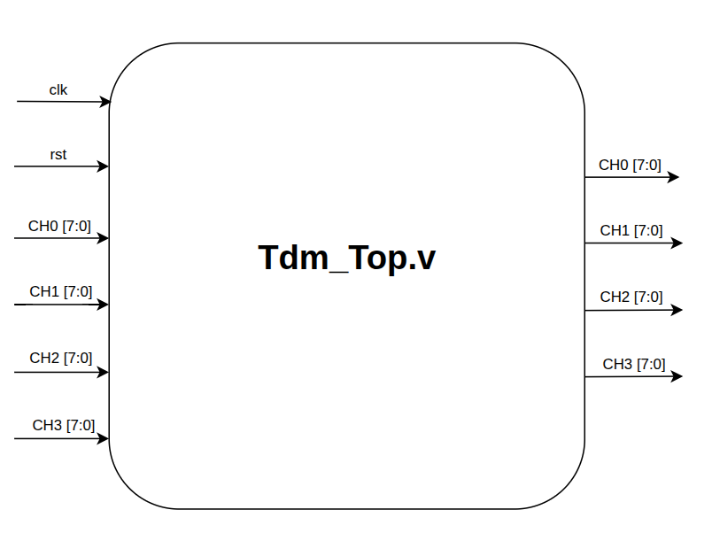

# TDM 4-Channel Multiplexer/Demultiplexer — Verilog RTL Project

A counter-driven (no FSM) **4-channel Time Division Multiplexing (TDM) multiplexer/demultiplexer** in
Verilog, with self-checking testbenches, a Python golden model that cross-checks the RTL, and Vivado
synthesis results.

| | |
|---|---|
| Design | 6 RTL modules, 1 shared 5-bit counter, 8-bit × 4 channels over a single `TDM_DATA` wire |
| System testbench | **38 / 38** checks pass (Icarus Verilog and Vivado XSIM), see [Section 8](#8-verification) |
| Golden model | **200 / 200** random vectors match bit-for-bit (stream, outputs, latency), see [Section 8.3](#83-python-golden-model-rtl-vs-reference) |
| Latency | 33 clocks from reset to first valid frame, 40 clocks (max 41) after a mid-stream data change |
| Synthesis | Vivado 2020.2, Kintex-7 `xc7k70tfbv676-1`: **22 LUTs, 63 FFs**, no BRAM/DSP; timing met at 100 MHz (WNS +6.574 ns, WHS +0.159 ns), see [Section 9](#9-synthesis-results) |

---

## Table of Contents

1. [Quick Start](#1-quick-start)
2. [System Overview](#2-system-overview)
3. [Block Diagram](#3-block-diagram)
4. [Repository Structure](#4-repository-structure)
5. [Module Index](#5-module-index)
6. [Timing Contract (glue layer in `tdm_top`)](#6-timing-contract-glue-layer-in-tdm_top)
7. [Interface Specifications](#7-interface-specifications)
8. [Verification](#8-verification)
9. [Synthesis Results](#9-synthesis-results)
10. [Limitations](#10-limitations)
11. [Future Work](#11-future-work)
12. [License](#12-license)

---

## 1. Quick Start

```bash
git clone https://github.com/Ygbzyem/TDM-4---Channel-Multiplerxer-Demultiplexer.git
cd TDM-4---Channel-Multiplerxer-Demultiplexer
```

You need **Python 3.8+** and **one** simulator: Icarus Verilog (`iverilog`, `vvp`) or Vivado (XSIM).
Keep the project in a folder whose path contains only ASCII characters (no accents) if you simulate
with Vivado.

```bash
python scripts/run_tests.py                      # system testbench -> 38/38 PASS
python golden_model/run_verification.py          # RTL vs Python golden model -> ALL CHECKS PASSED
```

Add `--sim xsim` to either command to use Vivado XSIM instead of Icarus. The full guide, including
the Vivado GUI flow and expected output, is in **[docs/SIMULATION.md](docs/SIMULATION.md)**; the golden
model is documented in **[golden_model/README.md](golden_model/README.md)**.

---

## 2. System Overview

The system is a single, fully periodic data path — no FSM, no handshake, no synchronization protocol, and no
alternate modes.

Instead of four wires for four channels, time is divided into fixed slots and each channel only "speaks" during
its own slot, in a fixed rotation:

- Each **byte** (8 bits) occupies exactly 8 clock cycles, MSB first.
- One **frame** is 4 consecutive bytes, always in the order CH0 → CH1 → CH2 → CH3 → (repeat): 32 clock cycles per frame.
- There is exactly **one counter** in the whole system (`bit_count`, free-running 0→31→0), the single timing
  reference for both transmit and receive sides. No other counter, clock or FSM exists in the design.

On the transmit side the active channel's byte is loaded into a shift register and sent out one bit per clock. The
receive side counts on the same beat, so it already knows which channel each completed byte belongs to and writes
it into the matching output register; no extra synchronization bits are needed.

One practical detail appears once this runs in real hardware: the shift registers are synchronous, so a value
loaded into them only takes effect on the *next* clock edge. The design compensates with a small glue layer in
`tdm_top` ([Section 6](#6-timing-contract-glue-layer-in-tdm_top)), and the outputs then match the inputs exactly
once the pipeline has filled.

**Latency.** Outputs are not valid instantly: after reset the first correct frame is available after **33 clocks**;
after a mid-stream change of the inputs it takes **40 clocks** (worst case 41 = 31 clocks waiting for the channel's
load slot + 8 clocks to serialize + 2 output registers). These numbers are measured in simulation and checked by
the golden model ([Section 8.3](#83-python-golden-model-rtl-vs-reference)).

---

## 3. Block Diagram


*Data flow: CH0–CH3 → `tdm_mux` (combinational) → `tx_shift_reg` (parallel→serial, MSB-first) → serial
`TDM_DATA` → `rx_shift_reg` (serial→parallel, MSB-first) → `tdm_demux` (updates an output only when
`byte_done = 1`) → CH0_OUT–CH3_OUT, all timed off the single `tdm_counter`.*

---

## 4. Repository Structure

```
.
├── src/                         # synthesizable RTL
│   ├── tdm_counter.v            #   5-bit free-running counter (timing source)
│   ├── tdm_mux.v                #   4-to-1 channel multiplexer
│   ├── tx_shift_reg.v           #   parallel-to-serial shift register
│   ├── rx_shift_reg.v           #   serial-to-parallel shift register
│   ├── tdm_demux.v              #   byte router to CHx_OUT registers
│   └── tdm_top.v                #   top level + timing glue layer
├── techbench/                   # testbenches
│   ├── tb_tdm_top.v             #   full-system test (3 layers of checks)
│   ├── tb_tdm_top_filebased.v   #   file-driven testbench used by the golden model flow
│   └── testbench.md             #   walkthrough of tb_tdm_top.v
├── golden_model/                # Python reference model + automatic RTL comparison (see its README)
│   ├── run_verification.py      #   simulate + compare in one command
│   ├── golden_model.py, compare_output.py, export_excel.py, ...
│   └── verification_logs/       #   latest result files, report and Excel workbook
├── input/                       # input vectors (input_vectors.hex, random_vectors.hex)
├── scripts/
│   ├── run_tests.py             #   runs every self-checking testbench
│   └── synth.tcl                #   Vivado batch synthesis + utilization/timing reports
├── constraint/constraints.xdc   # clock constraint (pin assignments pending a target board)
├── image/                       # block diagrams
├── docs/                        # SIMULATION.md and design notes
├── LICENSE
└── README.md
```

---

## 5. Module Index

| # | Module | File | Role |
|---|--------|------|------|
| 1 | `tdm_counter` | `tdm_counter.v` | The system's single timing source. Free-running 5-bit counter `bit_count` (0→31→0), with `channel_select = bit_count[4:3]` as its own direct output. |
| 2 | `tdm_mux` | `tdm_mux.v` | Combinational 4-to-1 MUX. Selects the active channel's byte for serialization. |
| 3 | `tx_shift_reg` | `tx_shift_reg.v` | Parallel-to-serial shift register, MSB-first. Loads a new byte on `load`, otherwise shifts left once per clock. |
| 4 | `rx_shift_reg` | `rx_shift_reg.v` | Serial-to-parallel shift register, MSB-first. Shifts continuously; on `byte_boundary` it latches the byte into `rx_data` and pulses `byte_done`. |
| 5 | `tdm_demux` | `tdm_demux.v` | Routes the completed byte into the correct `CHx_OUT` register, gated by `byte_done`. |
| 6 | `tdm_top` | `tdm_top.v` | Top-level integration: instantiates the five modules above plus the glue logic that derives correctly-phased `mux_select` / `load` / `byte_boundary` / `demux_select` from the counter's raw outputs. |

---

## 6. Timing Contract (glue layer in `tdm_top`)

`tdm_counter` only produces the raw `bit_count` and `channel_select = bit_count[4:3]`. Because `tx_shift_reg` and
`rx_shift_reg` are synchronous, three small pieces of glue logic in `tdm_top.v` translate the counter's raw outputs
into correctly-phased control signals, **without modifying any of the five sub-modules**:

| Signal | Formula in `tdm_top` | Why |
|---|---|---|
| `mux_select` | `(bit_count + 1)[4:3]` | Look one step ahead so `tx_shift_reg` receives the *upcoming* channel's byte one clock before it starts shifting it out. |
| `load`, `byte_boundary` | `bit_count[2:0] == 3'b111` | Fire on the **last** bit of the current byte, not the first bit of the next one, so a byte is loaded/captured exactly on time. |
| `demux_select` | `channel_select` delayed by 1 clock | Keeps the channel selector aligned with `byte_done`, which is itself a registered (1-cycle-late) pulse from `rx_shift_reg`. |

Without the look-ahead the channels rotate permanently by one (inputs `AA/BB/CC/DD` appear as `DD/AA/BB/CC`), which
is why the glue layer exists. `tx_shift_reg` also **preloads `mux_out` on reset** instead of clearing to `8'h00`:
`bit_count` is held at 0 during reset, so `mux_select` already points at CH0 and CH0 is the first channel to complete a round trip
after reset. Details and worked examples are in [docs/tdm_top.md](docs/tdm_top.md).

---

## 7. Interface Specifications

### 7.1 `tdm_counter`


| Port | Direction | Width | Description |
|---|---|---|---|
| `clk`, `rst` | Input | 1-bit | Shared clock, synchronous active-high reset |
| `bit_count` | Output | 5-bit | Free-running 0→31→0 counter, sole timing source of the system |
| `channel_select` | Output | 2-bit | `bit_count[4:3]`, raw/unregistered; not fed directly to `tdm_mux`/`tdm_demux` (see [Section 6](#6-timing-contract-glue-layer-in-tdm_top)) |

### 7.2 `tdm_mux`


| Port | Direction | Width | Description |
|---|---|---|---|
| `CH0`..`CH3` | Input | 8-bit ×4 | The 4 parallel input channels |
| `channel_select` | Input | 2-bit | 00→CH0, 01→CH1, 10→CH2, 11→CH3 |
| `mux_out` | Output | 8-bit | Selected channel's byte (combinational) |

### 7.3 `tx_shift_reg`


| Port | Direction | Width | Description |
|---|---|---|---|
| `clk`, `rst` | Input | 1-bit | Shared clock, synchronous active-high reset |
| `mux_out` | Input | 8-bit | Byte to serialize, from `tdm_mux` |
| `load` | Input | 1-bit | Pulses once per byte to capture `mux_out` |
| `serial_out` | Output | 1-bit | `tx_shift[7]`, the current MSB |

Priority inside the always block: **RESET > LOAD > SHIFT**. On reset `tx_shift` preloads `mux_out` (see [Section 6](#6-timing-contract-glue-layer-in-tdm_top)).

### 7.4 `rx_shift_reg`


| Port | Direction | Width | Description |
|---|---|---|---|
| `clk`, `rst` | Input | 1-bit | Shared clock, synchronous active-high reset |
| `serial_data` | Input | 1-bit | Serial bit sampled once per clock |
| `byte_boundary` | Input | 1-bit | Same role as `load`, seen from the RX side |
| `rx_data` | Output | 8-bit | Reconstructed byte, MSB-first |
| `byte_done` | Output | 1-bit | 1-clock pulse, one cycle after `byte_boundary` was asserted |

### 7.5 `tdm_demux`


| Port | Direction | Width | Description |
|---|---|---|---|
| `clk`, `rst` | Input | 1-bit | Shared clock, synchronous active-high reset |
| `rx_data` | Input | 8-bit | Completed byte from `rx_shift_reg` |
| `channel_select` | Input | 2-bit | Which `CHx_OUT` to update |
| `byte_done` | Input | 1-bit | Update gate; writes only when high |
| `CH0_OUT`..`CH3_OUT` | Output | 8-bit ×4 | Reconstructed channels; unselected channels hold their value |

### 7.6 `tdm_top`



| Port | Direction | Width | Description |
|---|---|---|---|
| `clk`, `rst` | Input | 1-bit | Shared clock, synchronous active-high reset |
| `CH0`..`CH3` | Input | 8-bit ×4 | The 4 parallel input channels |
| `TDM_DATA` | Output | 1-bit | Serialized output line |
| `CH0_OUT`..`CH3_OUT` | Output | 8-bit ×4 | Reconstructed channels |

---

## 8. Verification

### 8.1 System testbench (`python scripts/run_tests.py`)

| Testbench | Checks | What it covers |
|---|---|---|
| `tb_tdm_top` | **38 / 38 PASS** | full system (`tdm_top`), see below; Icarus Verilog, also confirmed on Vivado XSIM |

The project does not keep separate per-module testbenches: every module is exercised through `tdm_top`, and the timing
glue between the modules is the part that actually needs checking.

`tb_tdm_top` checks the complete `tdm_top` in three independent layers: (1) round trip per frame including `0x00`/`0xFF`
and a mid-stream reset, (2) a bit-level comparison of all 32 bits on `TDM_DATA` against the expected MSB-first sequence
(so a TX bug and an RX bug that cancel out cannot hide), and (3) a regression of 20 back-to-back random frames. A walkthrough is in
[techbench/testbench.md](techbench/testbench.md).

### 8.2 Simulator portability

`tb_tdm_top` deasserts reset with a `#1` delay after the clock edge. Without it, the assignment would land in the same
time step as the edge the DUT samples `rst` on, and the Verilog standard does not fix the order, so the result could
differ between simulators from byte-identical source.

### 8.3 Python golden model (RTL vs reference)

`techbench/tb_tdm_top_filebased.v` reads input vectors from `input/*.hex`, drives the real `tdm_top`, and writes three
result files. `golden_model/run_verification.py` then compares **every vector** with the independent Python model
([golden_model/README.md](golden_model/README.md)):

| Check | RTL side | Golden side |
|---|---|---|
| Bit stream | 32 bits on `TDM_DATA` of one frame, from `bit_count == 0` | `serialize()`, compared cycle by cycle |
| Outputs | settled `CH0_OUT..CH3_OUT` | `deserialize()` result |
| Latency | clocks until all four outputs are correct | bound `MAX_LATENCY = 41` |

| Run | Vectors | Result | Latency (cycles) |
|---|---|---|---|
| `input/input_vectors.hex` (hand-picked, corner values) | 20 | all PASS | cold start 33, mid-stream 40 |
| `input/random_vectors.hex` (`--n 200 --seed 42`) | 200 | all PASS | cold start 33, mid-stream 32–40 |

Each run also appends to `golden_model/verification_logs/verification_results.xlsx` (Summary / Results / History sheets).
A mid-stream latency below 40 appears when a channel's byte equals the previous vector's byte, so that channel needs no update.

---

## 9. Synthesis Results

Utilization report exported from Vivado 2020.2 after synthesis, target device Kintex-7 `xc7k70tfbv676-1`
(reproduce with `vivado -mode batch -source scripts/synth.tcl`):

| Resource | Used | Available | Utilization |
|---|---|---|---|
| Slice LUTs | 22 | 41,000 | 0.05% |
| Slice Registers (Flip-Flop) | 63 | 82,000 | 0.08% |
| Bonded IOB | 67 | 300 | 22.33% |
| Block RAM | 0 | 135 | 0% |
| DSP | 0 | 240 | 0% |
| BUFGCTRL (clock buffer) | 1 | 32 | 3.13% |

Primitive breakdown: 63 `FDRE` (all-synchronous design, no latches), 15 `LUT6` + 6 `LUT3` + 3 `LUT5` + 2 `LUT4` + 1 `LUT2` +
1 `LUT1`, 34 `IBUF` / 33 `OBUF`, and 1 `BUFG`. Bonded I/O is the dominant usage, which is expected with 4 × 8-bit inputs and
4 × 8-bit outputs plus clock, reset and the serial pin; no BRAM or DSP is needed.

### Timing (Vivado *Design Timing Summary*, 10 ns / 100 MHz clock constraint)

| Check | Worst slack | Failing endpoints | Endpoints |
|---|---|---|---|
| Setup (WNS) | **+6.574 ns** | 0 | 104 |
| Hold (WHS) | **+0.159 ns** | 0 | 104 |
| Pulse width (WPWS) | **+4.600 ns** | 0 | 65 |


Vivado reports: *All user specified timing constraints are met.* TNS, THS and TPWS are all 0.000 ns.

A rough estimate from the setup slack is a minimum clock period of about 10 − 6.574 = 3.43 ns, i.e. roughly 290 MHz.
This is an estimate derived from one run, not a guaranteed maximum frequency. The 100 MHz clock in `constraints.xdc` is a
placeholder, not a requirement from the specification, and the I/O delays are not constrained, so input and output paths
are not part of this result. Keep the `.rpt` file of the run in `results/` as evidence.

---

## 10. Limitations

- **Channel order after a mid-stream data change is not fixed.** Adding four input buffer registers that update only when `bit_count` wraps to 0 would remove this.
- **Rare edge cases are not covered yet:** back-to-back resets, a very short reset pulse, clock jitter. This only needs more test cases.
- **Channel count and data width are hard-coded.** Can be generalized with `NUM_CHANNELS` / `DATA_WIDTH` parameters and a `generate` loop.
- **No error detection and no frame synchronization marker.** A parity bit per byte and a small marker detector are feasible additions.
- **Out of scope:** CRC error detection and clock recovery / clock-domain crossing for a physically separate TX/RX clock.

---

## 11. Future Work

- Add the Vivado timing report file (`.rpt`) to `results/` and constrain the I/O delays so that input and output paths are analysed too.
- Choose a target board, set the real clock frequency and pin assignments in `constraint/constraints.xdc`.
- Add the input buffer registers described in [Section 10](#10-limitations) and extend the golden model to check them.
- Cover the remaining edge cases (short reset, back-to-back resets) in the testbenches.

---

## 12. License

Released under the MIT License, see [LICENSE](LICENSE).
